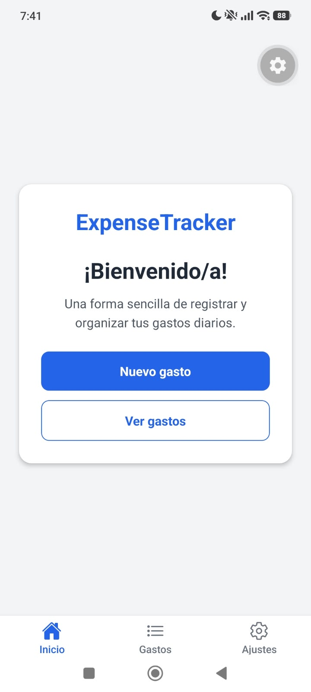
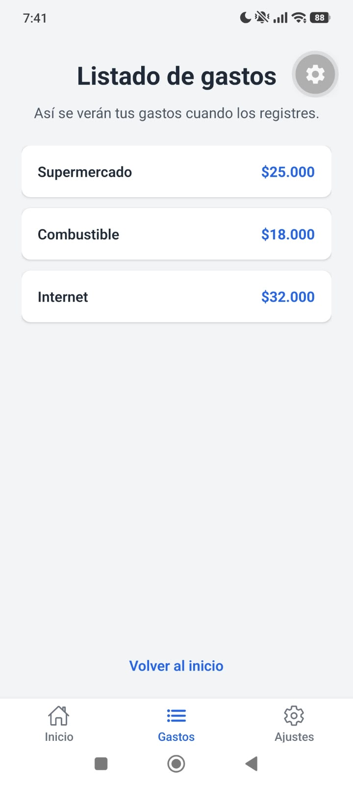
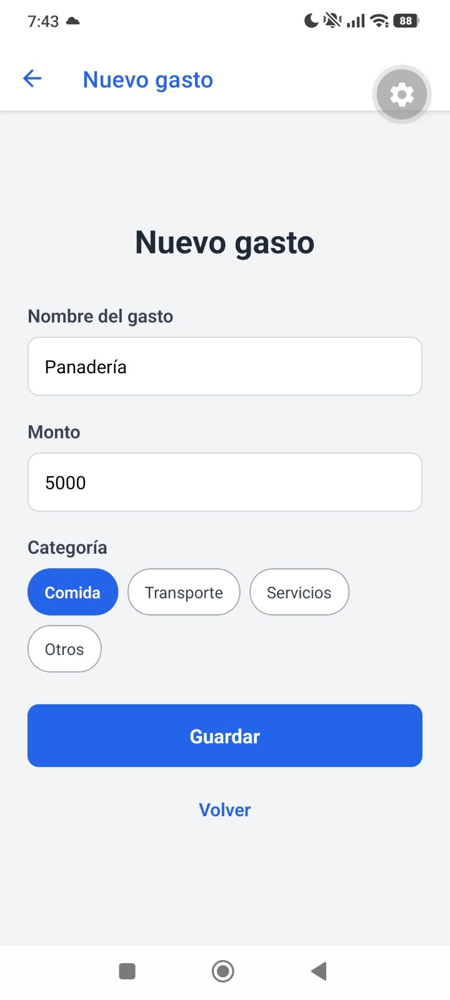
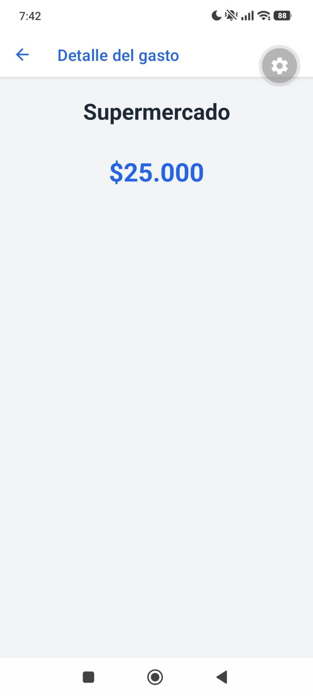
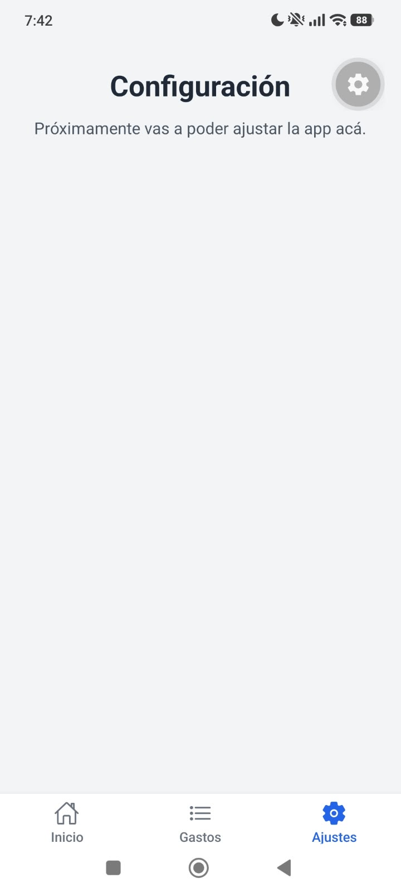

# ExpenseTracker

Aplicación móvil hecha con React Native y Expo para registrar y consultar gastos personales. Este repositorio corresponde al Sprint 1: prototipo navegable de la interfaz.

## Cómo ejecutarla

```bash
npm install
npx expo start
```

Escanear el QR con Expo Go.

## Capturas en Expo Go

### Inicio


### Listado de gastos


### Formulario de nuevo gasto


### Detalle del gasto


### Ajustes


## Persistencia local en React Native — US3

Los gastos y los ajustes se guardan en el dispositivo mediante AsyncStorage.

Se utilizan dos claves:
- `@expensetracker/expenses`: guarda el arreglo de gastos.
- `@expensetracker/settings`: guarda los valores de notificaciones y modo oscuro.

Las pantallas acceden a los datos a través del Context. Las operaciones de lectura y escritura se realizan dentro de ExpensesProvider.

### Hidratación

Al iniciar la aplicación, `isLoaded` comienza en `false`.

Un efecto lee los datos guardados y utiliza `JSON.parse` para reconstruir el arreglo de gastos y el objeto de ajustes. Después de cargar ambos en el estado, cambia `isLoaded` a `true`.

Mientras se realiza la lectura, App muestra un ActivityIndicator.

Si falla la lectura, se muestra un mensaje con la opción de reintentar. El guardado permanece bloqueado para evitar reemplazar información que no se pudo recuperar.

### Guardado

Un efecto guarda los gastos cuando cambia `expenses` y otro guarda los ajustes cuando cambia `settings`.

Ambos comprueban `isLoaded` antes de escribir y utilizan `JSON.stringify`.

Las operaciones con AsyncStorage utilizan `await` y manejan errores con `try/catch`.

### Importancia de isLoaded

Sin esta protección, el efecto de guardado puede escribir el arreglo vacío inicial antes de que termine la lectura de los gastos existentes.

### Pruebas pendientes

- Cerrar la aplicación desde el selector de apps y volver a abrirla en Expo Go.
- Comprobar que se conservan los gastos.
- Comprobar que se conservan los dos ajustes.
- Realizar con datos de prueba el experimento de quitar la protección de isLoaded y registrar el resultado.

Estas pruebas todavía no se realizaron.