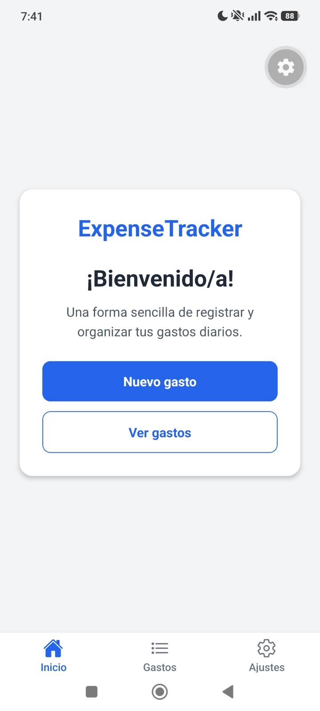
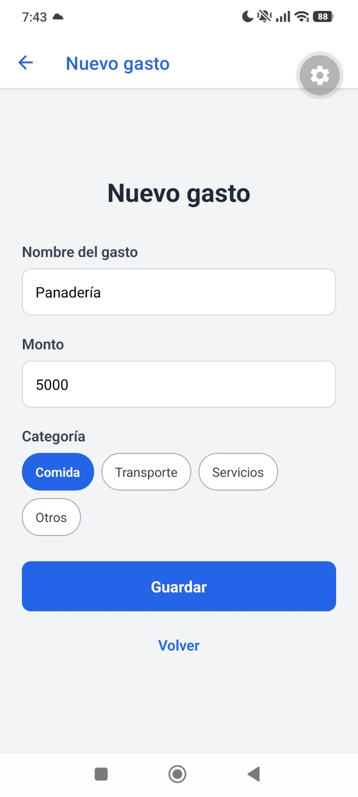

# ExpenseTracker

Aplicación móvil hecha con React Native y Expo para registrar y consultar gastos personales. Este repositorio corresponde al Sprint 1: prototipo navegable de la interfaz.

## Cómo ejecutarla

```bash
npm install
npx expo start
```

Escanear el QR con Expo Go.

## Capturas en Expo Go

### Inicio


### Listado de gastos


### Formulario de nuevo gasto


### Detalle del gasto


### Ajustes
